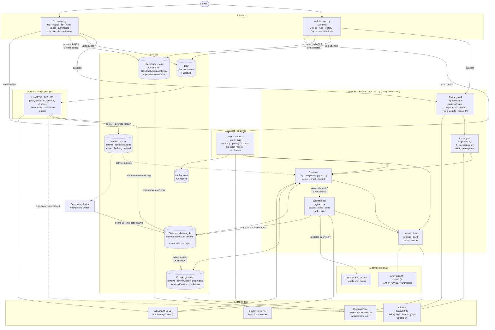
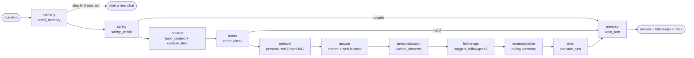
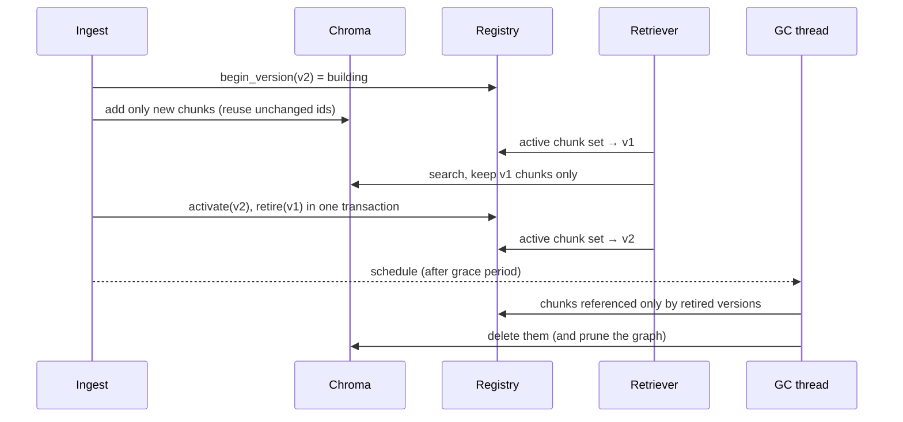
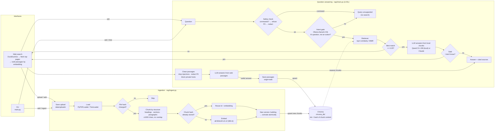
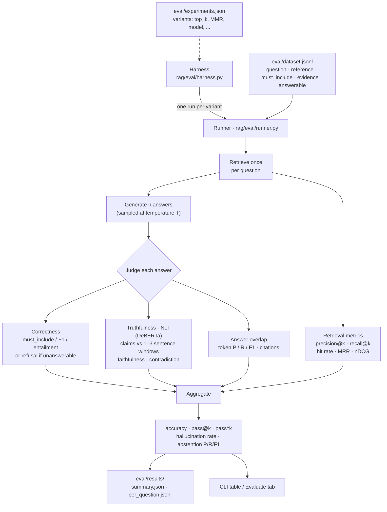

# LuminusRAG

*Guarded, self-evaluating GraphRAG for AI questions.*

Question answering over your own documents using LangChain, a persistent Chroma
vector store, local HuggingFace embeddings, and either a local Hugging Face LLM
(default `Qwen/Qwen2.5-1.5B-Instruct`) or Claude as the generator. Answers
include numbered source citations. An eval harness measures retrieval quality,
correctness, pass@k / pass^k, and truthfulness.

Only AI questions are answered. An Ollama model screens every question,
personal data is redacted before anything leaves the machine, and when the
local documents can't answer, the app searches the web and saves what it
learns. Latest scores are in [results.md](results.md); the research behind
each layer is cited in [researchpaper.md](researchpaper.md).

## Architecture



| Layer | Component | Job |
|---|---|---|
| Interfaces | `app.py`, `main.py` | Upload documents, ask questions, browse chunks, run evals |
| Policy guard | `rag/policy.py`, `rag/safety.py`, `policies/*.json` | Reject questions that violate the prompt-injection or PII policy (regex rules, then an LLM judge); redact contact details; sanitize uploaded documents, web passages, and answers |
| Intent | `rag/intent.py` + Ollama | Let through only AI questions, and no requests to perform actions |
| Retrieval | `rag/store.py` + Chroma | Find the top-k chunks for the question |
| Generation | `rag/chain.py` + Qwen or Claude | Answer only from the retrieved context, with citations |
| Web fallback | `rag/web.py` + DuckDuckGo | Search when local data can't answer; clean, rank, and save passages |
| Chat history | `rag/history.py` + LangChain `SQLChatMessageHistory` | Save every chat, reopen it, and summarize each chat |
| Knowledge graph | `rag/graph.py` + NetworkX + Ollama | Extract AI entities and relations from chunks; add connected facts and chunks to retrieval (GraphRAG) |
| Ingestion | `rag/ingest.py`, `rag/chunking.py`, `rag/versioning.py` | Chunk by structure, hash chunks, embed only changed ones, switch document versions atomically, garbage-collect old versions in the background |
| Evaluation | `rag/eval/` | Score retrieval, correctness, consistency, truthfulness, and the intent gate |

Everything runs locally except the web search and, if you choose it, Claude.

## Layout

```
LuminusRAG/
├── app.py               # web UI: upload & process, ask, browse chunks, evaluate
├── main.py              # CLI: ingest / add / docs / ask / chat / eval / bench
├── rag/
│   ├── config.py        # env-driven settings
│   ├── store.py         # Chroma vector store, embeddings, retriever
│   ├── ingest.py        # load -> OCR -> sanitize -> chunk -> versioned, content-addressed upsert
│   ├── ocr.py           # OCR for scanned PDF pages (RapidOCR + pypdfium2, local)
│   ├── observability.py # LangChain tracers: local SQLite span store, opt-in LangSmith (redacted)
│   ├── guardrails.py    # LangChain PII guardrail rules in/out + policy guard as create_agent middleware
│   ├── chunking.py      # stable structure-aware chunking (headings, sections, paragraphs), no overlap
│   ├── code_chunking.py # code chunked by imports / function / class / method (ast + brace scanner)
│   ├── watcher.py       # debounced re-indexing: quiet period -> chunk diff -> new version
│   ├── prompt_cache.py  # Ollama keep-alive factory + system-prompt cache warm-up
│   ├── versioning.py    # version registry, active chunk set, async garbage collector
│   ├── intent.py        # Ollama intent gate (AI questions only)
│   ├── web.py           # web fallback: search, fetch, clean, rank, store
│   ├── policy.py        # policy guard: regex + LLM checks against policies/*.json
│   ├── safety.py        # PII detectors, injection rules, output sanitizer
│   ├── history.py       # chat history (LangChain SQL store) + summaries
│   ├── graph.py         # GraphRAG: entity/relation extraction, graph store, hybrid retriever
│   ├── rerank.py        # cross-encoder reranking
│   ├── followup.py      # history-aware rewriting of follow-up questions
│   ├── chain.py         # retriever + prompt + LLM (LCEL)
│   ├── agent/           # agent harness: every layer a LangChain tool, run by LangGraph
│   │   ├── harness.py   # LangGraph state machine, step limit, streaming, trace
│   │   ├── tools.py     # memory / safety / context / retrieval / personalization / follow-ups / summary / eval tools
│   │   ├── personalize.py # interest profile -> personalized GraphRAG (ANN + personalized PageRank)
│   │   ├── followups.py # grounded, novel, safe follow-up suggestions (max 3)
│   │   └── memory.py    # session state (steps, rolling summary) + interest profile tables
│   └── eval/
│       ├── dataset.py   # JSONL eval set loader
│       ├── metrics.py   # retrieval, token P/R/F1, pass@k, pass^k, ...
│       ├── truthfulness.py  # NLI faithfulness / contradiction
│       ├── intent_eval.py   # intent gate accuracy
│       ├── guard_eval.py    # policy guard on labeled attack / benign questions
│       ├── llm_judge.py     # LLM-as-judge correctness + agreement / kappa
│       ├── security_eval.py # full-pipeline PII + prompt-injection eval
│       ├── agent_eval.py # personalization + 10-step follow-up sessions
│       ├── ocr_eval.py  # OCR CER/WER + retrieval on synthetic scanned PDFs
│       ├── chunk_eval.py # code retrieval by chunking strategy, edit locality, debounced sync
│       ├── latency.py   # latency stats (p50/p90/p95/p99) shared by every eval
│       ├── runner.py    # single eval run -> report
│       └── harness.py   # multi-variant experiments + comparison table
├── eval/
│   ├── dataset.jsonl    # labeled questions
│   ├── intent_dataset.jsonl # labeled allowed / blocked queries
│   ├── personalization_dataset.jsonl # ambiguous questions whose answer depends on the user's history
│   ├── agent_sessions.jsonl # persona sessions for the multi-step eval
│   ├── experiments.json # variants for `bench`
│   └── results/         # run outputs (gitignored)
├── policies/
│   ├── prompt_injection.json  # injection rules: patterns, examples, scope
│   └── pii.json               # PII rules and detectors
├── security-testing/    # poisoned test documents + original test plans
├── tests/               # chunking, debounce and prompt-cache tests (python tests/test_*.py)
├── data/                # put your .pdf / .txt / .md / source-code files here
├── requirements.txt
└── .env.example
```

## Setup

```bash
python -m venv .venv && source .venv/bin/activate
pip install -r requirements.txt
cp .env.example .env        # ANTHROPIC_API_KEY only needed with LLM_PROVIDER=anthropic
```

Questions pass through an Ollama intent check, so install Ollama too:

```bash
brew install ollama
ollama serve                # keep running, or: brew services start ollama
ollama pull llama3.2:3b
```

## Usage

```bash
streamlit run app.py                           # web UI at http://localhost:8501 (see below)
python main.py add report.pdf notes.md         # copy files into data/uploads and index them
python main.py docs                            # list indexed documents
python main.py ingest                          # sync index with data/ (incremental)
python main.py watch                           # re-index edits after 10 s without changes (debounced)
python main.py ingest --rebuild                # drop and rebuild the index
python main.py versions                        # document versions (active / building / retired)
python main.py gc                              # garbage-collect retired versions now
python main.py ask "What are the pipeline stages of RAG?"
python main.py chat                            # interactive
python main.py agent                           # multi-step agent: follow-up suggestions, 10 steps max
python main.py agent --trace                   # ...with the per-layer tool trace
python main.py eval-agent --compare            # personalization + session eval (vs personalization off)
python main.py ocr scan.pdf                    # OCR the scanned pages of a PDF and print the text
python main.py traces                          # recent traces (one per question)
python main.py traces 5edb8933                 # one trace as a span tree (timing, model, tokens)
python main.py traces --stats                  # p50 / p95 latency, errors, tokens by span
python main.py cache warm                      # prefill the system prompts into Ollama's prompt cache
python main.py cache status                    # prompt-cache hit rate per model (from traces)
python main.py eval-chunking                   # chunking strategies, edit locality, debounced sync
python tests/test_chunking.py                  # chunking + debounce tests (also: python -m pytest tests)
python main.py eval-ocr                        # OCR accuracy + retrieval on synthetic scans
python main.py eval -n 5 -k 1,3,5              # evaluate on eval/dataset.jsonl
python main.py bench                           # run + compare variants in eval/experiments.json
python main.py bench --only baseline,mmr -v
python main.py eval-intent                     # measure the intent gate
python main.py eval-guard                      # policy guard on 84 labeled attack/benign questions
python main.py eval-security -n 3              # full-pipeline PII + prompt-injection eval
python main.py graph build                     # extract new chunks into the knowledge graph
python main.py graph stats                     # entity and relation counts, most connected
python main.py graph show "HNSW"               # facts around an entity
python main.py chats                           # list saved chats
python main.py summarize                       # summarize each chat
python main.py summarize --overview            # ...plus an overview of all chats
python main.py summarize <chat_id>             # summarize one chat
```

The web UI has four tabs:

- **Upload & process**: drop PDFs/TXT/MD; each file is processed automatically
  with live steps (save → extract → split → embed + store) and a per-file
  report (pages, characters, chunks, time).
- **Traces**: one trace per question as a LangChain span tree with latency,
  tokens, errors and redacted inputs/outputs (see Observability).
- **Ask**: chat with your documents through the agent harness; every answer
  shows its sources, up to 3 follow-up buttons, the step counter (10 max) and
  an agent trace. The sidebar shows the interests learned from the conversation.
- **Documents**: indexed files, their chunks, and a remove button.
- **Evaluate**: run the eval harness and view accuracy, pass@k / pass^k,
  retrieval, truthfulness, and per-question results.

Ingestion is incremental and versioned: unchanged files are skipped, an edited
file re-embeds only the chunks that changed, and deleted files are retired and
cleaned up in the background (see Versioned ingestion).

## Observability and traceability

Tracing uses LangChain's callback and tracer system, so it needs no
instrumentation beyond naming the chains. Every question becomes **one trace**,
a tree of LangChain runs:

```
agent_turn [chain] 8661 ms
  safety > safety_check [tool]
    policy_judge:prompt_injection:query > ChatOllama [llm] llama3.2:3b in=968 out=66
    policy_judge:pii:query > ChatOllama [llm]
  context > build_context, contextualize > followup_rewriter
  intent > intent_check > intent_classifier > ChatOllama [llm]
  retrieve > PersonalizedRetriever > HybridRetriever > ActiveVectorRetriever [retriever]
  answer > answer_chain > ChatHuggingFace [llm] Qwen/Qwen2.5-1.5B-Instruct
  personalize, followups > followup_generator, summarize, evaluate, save
```

**Where traces go:**
- **Local (default, `TRACE_LOCAL=true`):** a LangChain `BaseTracer` writes each finished
  trace to SQLite (`traces/traces.sqlite`). Each run is stored as a span with its
  parent, type, latency, status, error, model, token counts, and inputs and outputs.
  Nothing leaves the machine.
- **LangSmith (opt-in):** set `TRACE_LANGSMITH=true` and `LANGSMITH_API_KEY`. This
  uses LangChain's `LangChainTracer` with a LangSmith client whose `hide_inputs` and
  `hide_outputs` hooks redact PII before upload. The raw question appears in the
  safety-check span, so this matters. Don't use `LANGSMITH_TRACING=true` instead:
  that turns on LangChain's automatic tracer, which uploads unredacted.

**What's recorded:**
- **Redaction and limits:** stored inputs and outputs are PII-redacted with the
  same detectors as `policies/pii.json` and truncated to `TRACE_MAX_CHARS`.
  Traces older than `TRACE_RETENTION_DAYS` are removed by `traces --purge`.
- **Traceability:** the trace id is saved with each answer in the chat history
  and shown under the answer, so an answer can be traced back to the documents,
  model calls, prompts and decisions behind it. The non-agent path (`ask`,
  `chat`, evals) is traced the same way, as a `guarded_pipeline` root.
- **Readable names:** every chain is named for its role (`policy_judge:pii:query`,
  `intent_classifier`, `answer_chain`, `followup_generator`, `graph_extractor`,
  `chat_summarizer`, `llm_judge`), so traces don't fill up with `RunnableSequence`.

**Viewing:**
- The **🔭 Traces** tab shows trace count, p50/p95 latency, errors and LLM tokens,
  with a per-trace span tree and redacted inputs and outputs for any span.
- `python main.py traces [ID] [--stats]` shows the same in the terminal.

## LangChain guardrails and a fast guard

**LangChain's PII guardrail** (`rag/guardrails.py`). LangChain 1.x ships PII
detectors and strategies (`RedactionRule`: email, credit_card, ip,
mac_address; block / redact / mask / hash). They run as an extra
deterministic layer in the guard:

- **Input:** a credit card number blocks the question; emails, IP and MAC
  addresses are redacted before any model sees the text.
- **Output:** the same types are redacted in every streamed segment.

LangChain's `[REDACTED_EMAIL]` placeholders match ours. LangChain adds
MAC addresses, which `policies/pii.json` didn't cover; ours covers SSNs,
IBANs, secrets, phone numbers and more.

**Policy guard as LangChain middleware.** `PolicyGuardMiddleware` runs
`check_query` in `before_agent` (stopping the agent with the rejection
message) and `sanitize_output` in `after_agent`. `guardrail_middleware()`
pairs it with LangChain's `PIIMiddleware`, so any `create_agent` agent gets
the same guardrails:

```python
from langchain.agents import create_agent
from rag.guardrails import guardrail_middleware

agent = create_agent(model, tools, middleware=guardrail_middleware())
```

`tests/test_guardrails.py` checks this with a real `create_agent` agent:

- **Injection** is stopped before the model is called.
- **Input PII:** an email in the question never reaches the model.
- **Output PII:** IP addresses and emails in the reply are redacted.
- **Benign questions** pass unchanged.

The harness itself is a LangGraph state machine, so it calls the same checks
from its safety node and output sanitizer instead of middleware hooks.

**Compact verdicts** (`GUARD_VERDICT=compact`). With the system prompts
served from the prompt cache, the judges' cost was decoding their answers:
about 60 tokens of JSON with a verdict, reason and evidence, around 600 ms
each. For questions the judges now reply with one line, `SAFE` or
`UNSAFE PI-02`, capped at 8 tokens. A line that can't be parsed falls back to
the structured judge.

- **Why the reason can go:** rejections only name the rule, never echo the text.
- **Documents keep the structured verdict,** because the quoted evidence is
  verified against the passage.
- **Parallel judges were tested and dropped:** running the two in parallel
  gave nothing (1,221 → 1,166 ms), since Ollama serves one request at a time.

| | before (JSON verdict) | compact verdict |
|---|---|---|
| guard p50 / p95 per question (86 questions) | 1,114 / 1,384 ms | **77 / 160 ms** |
| attacks blocked / benign allowed | 35/36 · 50/50 | 35/36 · 50/50 |
| agent safety layer p50 | 1,410 ms | **280 ms** |
| agent time to first token p50 | 2,124 ms | **1,222 ms** |
| agent turn p50 | 3,811 ms | **2,849 ms** |

## Prompt caching

The Ollama models (policy judges, intent classifier, follow-up rewriter and
generator, summarizer, graph extractor, LLM judge) each send a long fixed
system prompt of 100–970 tokens, then a short variable part. Ollama keeps the
KV cache of recent prompts and reuses the longest matching prefix, so a cached
system prompt costs almost nothing to evaluate. `rag/prompt_cache.py` makes
that reliable:

- **Fixed system prompts:** they contain no variables, which a test checks;
  per-request text goes in the user message. The cached prefix then matches
  byte for byte.
- **One `chat_ollama()` factory for every call,** with `keep_alive=30m`.
  Ollama's default is 5 minutes, after which the model and its cache are
  dropped. A reload costs about 530 ms, plus the cold prompt evaluation.
- **Warm-up:** at app start, and when `chat` or `agent` starts, all 9 system
  prompts are prefilled in the background (one output token each), so even
  the first question hits the cache. `python main.py cache warm` does it on demand.
- **Visibility:** traces record Ollama's prompt-evaluation time per LLM call
  and mark it as a cache **hit** or **miss**. The Traces tab and
  `python main.py cache status` show the hit rate.

Measured on llama3.2:3b:

| System prompt | Tokens | Cold prompt eval | Cached |
|---|---|---|---|
| policy judge: prompt injection | 968 | 314 ms (+527 ms model load) | 11 ms |
| policy judge: PII | 752 | 234 ms | 10 ms |
| intent classifier | 507 | 153 ms | 10 ms |
| follow-up rewriter / generator | 250 / 163 | 80 / 74 ms | 9 ms |

Ollama keeps all 9 prefixes cached at once.

**Where caching isn't added:**
- **Qwen answer model:** its system prompt is only 74 of about 1,040 prompt
  tokens. Reusing a precomputed KV cache for it saved 3 ms of time-to-first-token
  (140 → 137 ms), which isn't worth the complexity.
- **Anthropic provider:** the answer system prompt is below Anthropic's
  minimum cacheable length, so `cache_control` would do nothing.

## OCR for scanned PDFs

PDF pages with no usable text layer (fewer than `OCR_MIN_CHARS` characters)
are OCR'd during ingestion (`rag/ocr.py`):

- **Engine:** pages are rendered with pypdfium2 at `OCR_DPI` and read with RapidOCR
  (PP-OCR models on onnxruntime). Everything runs locally, with no system install
  and no network.
- **Reading order:** recognised lines are grouped into rows, and blank vertical space
  becomes a paragraph break, so the structure-aware chunker still packs by paragraph.
- **Low-confidence lines** (below `OCR_MIN_CONFIDENCE`) are dropped. RapidOCR's
  180° text-direction classifier is off: it flipped some upright lines into garbage
  and pushed character error to 2–5%.
- **Untrusted text:** OCR text goes through the same policy sanitizer as typed text,
  so prompt injection hidden in a scanned image is removed and PII is redacted.
- **Only changed files:** OCR runs only for new or changed files. Chunks from OCR'd
  pages carry `ocr: true`, and the upload view shows OCR progress, page count and
  mean confidence.

`python main.py eval-ocr` renders four corpus documents as image-only PDFs
(clean, skewed with blur and noise, and 100 dpi) and measures character and word
error rates and retrieval. On the clean scans the character error rate is 0.000,
and retrieval recall matches the native text (1.00). Full results are in
[results.md](results.md).

**Limitations:**
- Multi-column pages are read row by row across the columns.
- Headings aren't detected, so a scanned page is one section.
- There's no handwriting support.

## Agent harness (multi-step conversations)

LuminusRAG follows **harness engineering**: the models are small and fixed
(Qwen2.5-1.5B, Llama 3.2 3B, never fine-tuned), and every gain comes from the
harness around them. That harness covers the tools, context, memory, safety,
orchestration, tracing and evaluation, and each change is measured with the
model held fixed. See [researchpaper.md](researchpaper.md#7-harness-engineering).

The Ask tab and `python main.py agent` run every question through an agent
harness (`rag/agent/`). Each layer is a typed LangChain tool, and a
LangGraph state machine calls them in a fixed order. Safety has to run before
anything else sees the question, so a model doesn't choose the order. A conversation:

1. The user asks a question. The harness answers it from the retrieved
   documents and suggests **up to 3 follow-up questions**.
2. The user clicks a suggestion or types their own question.
3. Up to **10 steps** per chat (`AGENT_MAX_STEPS`). The chat then closes with a
   summary, and further questions get "start a new chat". Interests carry over.

Every turn also teaches the harness what the user is exploring. These
**interests** personalize retrieval and the follow-up suggestions.



| Layer | Tool | What it does |
|---|---|---|
| memory | `recall_memory`, `save_turn` | LangChain SQL chat history, session state (step count, rolling summary, closed), interest profile |
| safety | `safety_check`, `intent_check` | policy guard (injection + PII, regex + LLM judge) on the raw question; AI-only intent gate |
| context | `build_context`, `contextualize` | last 3 exchanges + rolling summary of older ones + interests, within a character budget; follow-ups rewritten to standalone questions (the rewrite must pass the guard again) |
| retrieval | `retrieve` | personalized GraphRAG (below) |
| generation | `generate_answer` | streamed, sanitized answer with citations; web fallback when the store can't answer |
| personalization | `update_interests` | decays interests ×0.8 per step, adds the entities this question was about |
| follow-ups | `suggest_followups` | ≤3 suggestions: grounded, novel, safe, on topic (below) |
| summarization | `summarize_session` | rolling summary every 3 steps once turns leave the recent window; final chat summary at the step limit |
| eval | `evaluate_turn` | online signals per turn: retrieval score, refusal, citations, lexical grounding, follow-up answerability (NLI faithfulness with `AGENT_ONLINE_NLI=true`) |

Every tool call is traced: layer, tool, milliseconds and a short note. The
UI shows the trace under each answer, and `agent --trace` prints it.

**Personalized GraphRAG.** The user's interests are knowledge-graph entities:

- **Where interests come from.** Each turn adds the entities the question names, found by
  ANN search over entity-name embeddings. With a lower weight it also adds entities from the top answering
  chunks, but only those close to the question, so "Google" in a passage doesn't become an interest.
- **What's stored.** Only entity keys, never question text, so the profile holds no PII.
- **How retrieval uses them:**
  1. **ANN:** a second vector search runs with the question embedding nudged toward the profile vector.
  2. **Personalized PageRank:** runs on the graph, restarting at the question's entities and the interests.
     Each chunk scores the PageRank mass of its entities.
  3. **Ranking:** `cos(q, chunk) + 0.15·cos(profile, chunk) + 0.1·PPR(chunk)`.
  4. **Additive:** the question's own top-k chunks are always kept. The profile adds up to 2 chunks and
     sets the order, so an unrelated profile can't push the answer out.

  On ambiguous questions ("What does recall mean?" after asking about HNSW, or after asking about MRR)
  personalization picks the right source more often (hit@1 0.50 → 0.67, MRR 0.51 → 0.76). On normal
  questions it costs no recall (1.00). Over 10-step sessions it raised answer faithfulness from 0.62 to
  0.70. Full tables are in [results.md](results.md).

**Follow-up suggestions.** The local Ollama model proposes 5 candidates from
the answer, the top passages and the interests. Knowledge-graph relations
supply templated candidates ("How does X relate to Y?") that only fill empty
slots. Every candidate must pass all of these checks:

- **Format:** one question, 4–25 words.
- **Safety:** the policy regex rules. A clicked follow-up is a normal question, so it then goes through the full guard and intent gate again.
- **Novelty:** cosine below 0.86 to everything already asked and to other suggestions.
- **Answerable:** an active chunk scores at least `FOLLOWUP_MIN_SCORE`.
- **On topic:** at least `FOLLOWUP_MIN_RELEVANCE` against the question or answer.

Survivors are ranked by answerability, relevance and interest. On the last
step no suggestions are made.

## Versioned ingestion

**Stable chunking** (`rag/chunking.py`). Chunks follow the document's
structure: Markdown headings open sections, and each chunk records its heading
path ("Vector Databases > Exact and approximate search"). Inside a section,
whole paragraphs are packed up to `CHUNK_SIZE` characters; code blocks and
tables stay whole; long paragraphs split at sentence boundaries; PDF pages are
sections. A chunk never crosses a section and there is no overlap, so editing
one paragraph changes only the chunk(s) of its own section. Structure-aware
chunks average about 400 characters (2.5x smaller than the old fixed-size
chunks), so `TOP_K` defaults to 8 to keep a similar amount of context; at 4,
retrieval recall on the main question set fell to 0.82.

**Code is chunked by syntax** (`rag/code_chunking.py`). Source files (`.py`,
`.js`/`.ts`, `.java`, `.go`, `.rs`, `.c`/`.cpp`, `.cs`, `.kt`, `.swift`,
`.scala`, `.php`) and long fenced code blocks in Markdown are split into:

- **imports:** all import / include / use statements, the file's libraries,
  plus the module docstring, in one chunk;
- **functions:** one chunk each, with their decorators and doc comments;
- **classes:** one chunk each. A class larger than `CHUNK_SIZE` becomes a
  header chunk plus one chunk per method;
- **module code:** other top-level statements, grouped in order.

Python is parsed with `ast`. The brace languages use a scanner that tracks
brace depth and skips strings and comments. The chunks partition the file:
every line is in exactly one chunk, so there's no overlap and nothing is lost.
The heading path (`chain.py > class GuardedPipeline > def events`) is stored
with the code, but line numbers aren't, so inserting code above a function
doesn't change that function's hash. Tests in `tests/test_chunking.py` check
the partition and edit locality.

**No overlap anywhere.** Documents, code and web passages all use the
structure-aware chunker, and web passages no longer use a 150-character
overlap. With overlap, a chunk's text includes part of its neighbour, so an
edit near a boundary changes the hashes of two chunks and both get
re-embedded.

**Debounced re-indexing** (`rag/watcher.py`, `python main.py watch`, or the
**Auto-sync** toggle in the sidebar). Editors save repeatedly, so the watcher
waits until no file in `data/` has changed for `DEBOUNCE_SECONDS` (10 s,
capped at `DEBOUNCE_MAX_SECONDS`). Then, for the changed files only, it
rebuilds the chunks and diffs them by hash against the live version
(unchanged / new / removed). Only after that does it build and activate the
new version, embedding just the new chunks. In the eval, four saves within
six seconds led to one sync, 10 s after the last save. It built one version
per changed file (2 instead of 4) and re-embedded 2 of 19 chunks. A lock
stops the watcher and UI uploads from indexing at the same time.

**Content-addressed chunks.** A chunk's id is a hash of its document and text.
When a file changes, unchanged chunks keep their id and embedding and only new
chunks are embedded. In testing, editing one paragraph of a 4-chunk document
embedded 1 chunk and reused 3.

**Versions** (`rag/versioning.py`, registry in `chroma_db/registry.sqlite`).
Each update creates a new document version:

1. **building**: new chunks are written to Chroma and the knowledge graph,
   but the retriever only serves chunks of *active* versions, so queries keep
   seeing the previous version.
2. **active**: when the version is complete, one transaction activates it and
   retires the previous one. The next query sees the new version; chunks only
   the old version used are hidden at once.
3. **garbage collection**: a background thread waits `GC_GRACE_SECONDS` for
   in-flight queries, then deletes chunks no active or building version uses
   (from Chroma and the graph), drops retired versions, fails builds that
   were abandoned for `GC_STALE_BUILD_SECONDS`, and removes chunks from the
   old unversioned scheme. A failed update leaves the old version live.

Deleting a file retires its document immediately and the GC removes its
chunks. Web passages are not versioned and are always live.



CLI: `python main.py versions` (history per document), `python main.py chunks
data/vector_databases.md` (active chunks with ids and headings), and `python
main.py gc` (collect now).

## GraphRAG (knowledge graph)

Vector search finds chunks that look like the question. A knowledge graph adds
what is *connected* to the things the question names, which helps when an
answer spans several chunks or documents (HNSW → ANN index → vector database
→ Chroma).

- **Build:** an Ollama model reads each stored chunk and extracts AI entities
  (concepts, models, techniques, metrics, tools, benchmarks, ...) and relations
  (`is_a`, `uses`, `stores`, `alternative_to`, ...). Entities must appear in
  the chunk text, relations must join two entities named in the same
  sentence, generic words and PII are dropped, and every node and edge keeps
  the ids of the chunks it came from. Chunks are already policy-sanitized, so
  injected text never reaches the graph.
- **Store:** a NetworkX graph in `chroma_db/knowledge_graph.json`, updated
  incrementally after `ingest`, after uploads, and when web passages are
  saved; facts from deleted chunks are removed.
- **Retrieve:** `RETRIEVAL_MODE=vector` (vector search only), `graph`
  (graph only, falling back to vector), or `hybrid` (vector results plus up
  to `GRAPH_K` chunks linked to the question's entities and a list of the
  connecting facts).
- **Browse:** the **Graph** tab in the web UI shows the most connected
  entities and draws the neighbourhood of any entity.

Hybrid is the default: on 10 relational questions it raised accuracy from
0.70 to 0.83 and pass^3 from 0.50 to 0.70 compared with vector search, and on
the original 21 questions it was on par (0.71 vs 0.73) with fewer
hallucinations. Graph-only retrieval was worse (0.60), because chunks the
graph did not capture are missed. See [results.md](results.md).

## Reranking

With `RERANK=true`, the retriever (vector, graph or hybrid) fetches
`RERANK_FETCH_K` candidates (default 20) and a cross-encoder
(`cross-encoder/ms-marco-MiniLM-L-6-v2`) scores each question-passage pair
together; the best `TOP_K` are kept. Knowledge-graph fact summaries are not
reranked and are always kept. It is off by default: in our benchmark it
raised MRR from 0.79 to 0.97 but did not improve accuracy, lowered it on
relational questions (0.77 to 0.63, because multi-hop answers need more than
the top 4 chunks), and added about 35% latency. Compare it with
`python main.py bench --config eval/experiments_extensions.json`.

## Follow-up questions (history-aware retrieval)

In a chat, follow-ups such as "What is its main cost?" are rewritten into a
standalone question ("What is the main cost of HNSW?") before the intent
check and retrieval, using LangChain's history-aware retriever pattern and the
local Ollama model. Only questions that look like follow-ups (pronouns, "what
about", "the two") are rewritten; standalone questions pass through
unchanged. The rewrite must pass the regex policy rules, and the UI shows
what the question was read as. History comes from the stored, PII-redacted
chat. On the 10 follow-ups in `eval/followup_dataset.jsonl` it raised accuracy
from 0.40 to 0.83 and retrieval recall from 0.70 to 1.00.

## LLM-as-judge

With `LLM_JUDGE=true`, `eval` and `bench` also ask a local judge model to
grade each answer against the reference (correct or incorrect, score 1-5),
next to the rule-based correctness and the NLI truthfulness metrics. Because
small judges have known biases, the report includes the judge's agreement
with the rule-based grade and Cohen's kappa, so you can see how far to trust
it. On the main question set it agreed with the rules 87-92% of the time
(kappa 0.65-0.80); on smaller sets agreement was much lower, so the
rule-based grade stays primary. Refusals are graded by rule, and the judge
replies in a plain two-line format because JSON output made the 3B model
reject correct paraphrases.

## Streaming

Answers stream in the web UI and in `ask` / `chat`. While the checks run, a
status line shows each stage (safety policies, AI-topic check, document
search, web search); then the answer appears as it is generated.

Streaming never bypasses the output sanitizer. Tokens are buffered into whole
sentences or lines, and each piece is sanitized (PII and secrets redacted,
images and unknown links removed) before it is shown, so raw model output
never reaches the screen. If the first sentence of a local answer is "I don't
know", it is not shown: generation stops and the web answer streams instead.

In code, `build_guarded_chain()` returns a `GuardedPipeline` with
`.invoke(question)` (final result), `.events(question)` (status, token, and
final events), and `.stream(question)` (answer text only).

## Chat history and summaries

Chats are stored with LangChain's `SQLChatMessageHistory`: each chat is a
session of `HumanMessage` / `AIMessage` objects in a local SQLite database
(`chats/history.sqlite`, gitignored), with answer metadata and sources kept in
`additional_kwargs`. Set `CHAT_DB_URL` to any SQLAlchemy URL (for example
Postgres) to share history between machines. Questions are saved with personal
data already redacted.

- **Web UI:** the sidebar lists chats to reopen or delete; **New chat** starts
  another. The **History** tab shows every chat with its own summary, a
  **Summarize each chat** button, and an overview of all chats.
- **CLI:** `chat` sessions are saved too; `chats` lists them and `summarize`
  summarizes each one.

Summaries come from the local model and are cached until the chat gets new
messages. To keep them honest, refused questions are hidden from the model
and listed separately under "Not answered", and the all-chats overview is
assembled from each chat's topics by code rather than generated, because the
small local model dropped and invented content when merging summaries.

## Intent gate

Every question from `ask`, `chat` and the web UI is classified by Ollama first.
Only AI questions are searched; the rest get "Query unsupported". If Ollama is
unreachable the gate fails closed: nothing is searched and the reply says the
intent check is unavailable. Set `INTENT_ENABLED=false` to turn the gate off.
`eval` and `bench` call retrieval directly, so they measure the RAG pipeline
without the gate; `eval-intent` measures the gate on its own.

## Policy guard

Two JSON policies define what is unsafe:

- `policies/prompt_injection.json`: PI-01 instruction override, PI-02 system
  prompt extraction, PI-03 source/file/secret exfiltration, PI-04 command or
  tool execution, PI-05 fake authority or mode switch, PI-06 encoded
  instructions, PI-07 instructions addressed to an AI inside content.
- `policies/pii.json`: PII-01 requests for another person's data, PII-02
  social engineering, PII-03 memory or training-data leakage, PII-04
  high-risk identifiers or credentials in the input (reject), PII-05 contact
  details (redact), plus the detectors used for redaction.

Each rule has a description, regex patterns, unsafe and safe examples, an
action, and `applies_to` (`query`, `document`, or both).

**Questions** go through `check_query` before anything else: regex rules and
detectors first, then an Ollama model prompted with each policy's rules and
examples. If either finds the question unsafe it is rejected, naming the rule.
If the model can't be reached, the question is rejected (fail closed).

**Uploaded documents** go through `sanitize_document` before indexing: HTML
comments and images are removed, paragraphs that break a document-scoped
injection rule are dropped (regex, or an LLM verdict whose quoted evidence is
verified in the text), and PII is redacted, including names of private
individuals found next to other personal data. Code blocks and text that only
discusses prompts or attacks are kept. Policy changes re-index all files.

**Answers** go through `sanitize_output`: PII and secrets are redacted, and
images and links to hosts outside the sources are removed. Source excerpts
are displayed as plain text.

## Safety

| Risk | Protection |
|---|---|
| Personal data leaving the machine | Emails, phone numbers, card numbers (Luhn-checked), SSNs, Aadhaar/PAN, IBANs, IP addresses, and API keys/passwords are redacted from the question before anything else runs. Only the redacted text reaches the intent model, the search engine, and the store. |
| Running commands | Nothing in the pipeline executes code: the LLMs have no tools and output is only displayed or stored as text. Questions containing shell, code, or SQL commands are refused before any model sees them. |
| Requests to perform actions | The Ollama intent gate refuses requests to run, fetch, access, send, or download anything, in any language. `eval-intent` includes Spanish, French, and Hindi examples. |
| Instructions hidden in web pages | Hidden elements (`display:none`, `hidden`, `aria-hidden`, zero-size text) are removed; passages with injection phrases (several languages) are dropped; the prompt tells the model to treat context as data. |
| Fetching internal resources | Only public `http(s)` URLs on ports 80/443 are fetched. Hosts resolving to loopback, private, link-local, or reserved IPs are refused, including after redirects. |
| Personal data stored from the web | Web passages are PII-redacted before they are answered from or saved. |

Pattern-based checks can't catch everything (for example, names are not
detected as PII). With `LLM_PROVIDER=anthropic`, the redacted question and
context are sent to the Anthropic API.

## Web fallback

Allowed questions that the local store can't answer are searched online with
DuckDuckGo (no API key). The top pages are fetched, cleaned of navigation and
scripts, split into chunks, and ranked by embedding similarity to the question;
the best passages become the context. When they produce a real answer, the
passages that closely match the question (cosine >= `WEB_STORE_MIN_SCORE`,
default 0.45) are saved into Chroma (`origin=web`, with URL, title, and fetch time),
so later questions on the same topic are answered locally. Stored web passages
appear in the Documents tab with a remove button, and `ingest` leaves them
alone. Set `WEB_STORE=false` to answer from the web without saving. Set
`WEB_FALLBACK=false` to answer from local documents only. DuckDuckGo may rate
limit heavy use; failures are reported and the answer falls back to "I don't
know".

## Evaluation

`eval/dataset.jsonl` holds one labeled question per line:

```json
{"id": "embed_dims", "question": "...", "reference": "gold answer",
 "must_include": ["384"], "evidence": ["384-dimensional embeddings"]}
{"id": "unans_price", "question": "...", "answerable": false}
```

For each question the harness retrieves once, generates `n` answers (sampled
at `--temperature` when n > 1), judges every answer, and aggregates:

| Group | Metrics |
|---|---|
| Generation | accuracy, pass@k (at least 1 of k correct), pass^k (all k correct), both with unbiased estimators |
| Retrieval | precision@k, recall@k, hit rate, MRR, nDCG (a chunk is relevant if it contains an `evidence` string) |
| Answer | token precision / recall / F1 vs `reference`, citation rate and validity |
| Truthfulness | faithfulness (claims entailed by retrieved text), contradiction rate, reference entailment, hallucination rate, claim coverage |
| Abstention | precision / recall / F1 of "I don't know" on unanswerable questions |
| Latency | per sample: time to first token, generation time, end-to-end (rewrite + retrieval + generation), output tokens/s; per question: retrieval and rewrite time. Each reported as mean / p50 / p90 / p95 / p99 / max |

An answer is correct if it contains every `must_include` phrase (else token
F1 >= 0.5 or it entails `reference`); for unanswerable questions it must
refuse. Truthfulness uses a local NLI model
(`MoritzLaurer/DeBERTa-v3-base-mnli-fever-anli`) against 1-3 sentence windows
of the retrieved chunks. Very short answers (e.g. "384") have no checkable
claims and are excluded from faithfulness (`claim_coverage` reports how many
were scored).

Every eval reports latency with the same distribution stats (`rag/eval/latency.py`):

| Eval | Latency metrics |
|---|---|
| `eval`, `bench` | time to first token, generation, end-to-end, retrieval, rewrite, tokens/s; `bench` adds `e2e_p50`, `e2e_p95`, `ttft_p50` columns |
| `eval-guard` | per-query guard latency, split by attacks and benign questions |
| `eval-intent` | per-query classifier latency |
| `eval-security` | end-to-end latency per question, split by blocked and answered |
| `eval-agent` | turn latency, time to first token, p50 / p95 per harness layer |
| `eval-chunking` | chunking time per file, query latency per strategy, sync time, last save → live |
| `eval-ocr` | seconds per page per scan condition |

Live traffic gets the same view from traces (`traces --stats`: p50 / p95 per span).

`bench` reads `eval/experiments.json`: lower-case keys (`n`, `ks`,
`temperature`, `top_k`, `limit`, `dataset`) are run settings, UPPER_CASE keys
override `rag/config.py` (e.g. `SEARCH_TYPE`, `HF_LLM_MODEL`, `LLM_PROVIDER`).
Each run writes `per_question.jsonl` and `summary.json` under `eval/results/`.

## Configuration (env vars)

| Variable | Default |
|---|---|
| `LLM_PROVIDER` | `huggingface` (or `anthropic`) |
| `HF_LLM_MODEL` / `HF_MAX_NEW_TOKENS` | `Qwen/Qwen2.5-1.5B-Instruct` / `512` |
| `ANTHROPIC_API_KEY` / `LLM_MODEL` | only for `anthropic` / `claude-sonnet-4-5` |
| `EMBED_MODEL` | `sentence-transformers/all-MiniLM-L6-v2` |
| `CHUNK_SIZE` | `1000` (max characters per chunk; by heading / paragraph / function, no overlap) |
| `CODE_MAX_CHARS` | `4000` (a longer function is split at its top-level statements) |
| `DEBOUNCE_SECONDS` / `DEBOUNCE_MAX_SECONDS` / `WATCH_POLL_SECONDS` | `10` / `60` / `1` |
| `OLLAMA_KEEP_ALIVE` / `PROMPT_CACHE_WARMUP` | `30m` / `true` |
| `GUARD_VERDICT` / `LANGCHAIN_PII` | `compact` (or `structured`) / `true` |
| `GC_GRACE_SECONDS` / `GC_STALE_BUILD_SECONDS` | `5` / `3600` |
| `TOP_K` / `SEARCH_TYPE` | `8` / `similarity` (or `mmr`) |
| `RETRIEVAL_MODE` / `GRAPH_K` | `hybrid` (or `vector`, `graph`) / `2` |
| `GRAPH_ENABLED` / `GRAPH_MODEL` | `true` / `llama3.2:3b` |
| `RERANK` / `RERANK_FETCH_K` / `RERANK_MODEL` | `false` / `20` / `cross-encoder/ms-marco-MiniLM-L-6-v2` |
| `HISTORY_AWARE` / `HISTORY_TURNS` | `true` / `3` |
| `LLM_JUDGE` / `JUDGE_MODEL` | `false` / `llama3.2:3b` |
| `INTENT_ENABLED` / `INTENT_MODEL` | `true` / `llama3.2:3b` |
| `OLLAMA_BASE_URL` | `http://localhost:11434` |
| `WEB_FALLBACK` / `WEB_MIN_SCORE` | `true` / `0.25` |
| `WEB_STORE` / `WEB_STORE_MIN_SCORE` | `true` / `0.45` |
| `WEB_MAX_RESULTS` / `WEB_FETCH_PAGES` / `WEB_TIMEOUT` | `5` / `3` / `10` s |
| `CHAT_DB_URL` | `sqlite:///chats/history.sqlite` |
| `NLI_MODEL` | `MoritzLaurer/DeBERTa-v3-base-mnli-fever-anli` |
| `OCR_ENABLED` / `OCR_DPI` / `OCR_MIN_CHARS` | `true` / `200` / `30` (pages with fewer text chars are OCR'd) |
| `OCR_MIN_CONFIDENCE` / `OCR_MAX_PAGES` | `0.5` / `300` per file |
| `TRACE_LOCAL` / `TRACE_DB_URL` | `true` / `sqlite:///traces/traces.sqlite` |
| `TRACE_MAX_CHARS` / `TRACE_RETENTION_DAYS` | `2000` / `14` |
| `TRACE_LANGSMITH` / `LANGSMITH_PROJECT` | `false` / `luminusrag` (needs `LANGSMITH_API_KEY`) |
| `AGENT_MAX_STEPS` / `AGENT_MAX_FOLLOWUPS` / `AGENT_MODEL` | `10` / `3` / `llama3.2:3b` |
| `FOLLOWUP_MIN_SCORE` / `FOLLOWUP_MIN_RELEVANCE` | `0.5` / `0.25` (cosine) |
| `SUMMARY_EVERY` / `AGENT_ONLINE_NLI` | `3` / `false` |
| `PERSONALIZE` / `INTEREST_DECAY` / `LONG_TERM_WEIGHT` | `true` / `0.8` / `0.3` |
| `PERSONAL_WEIGHT` / `PPR_WEIGHT` | `0.15` / `0.1` |
| `DATA_DIR` / `PERSIST_DIR` | `./data` / `./chroma_db` |

## How it works

### Request flow



1. **Ingest:** files are loaded page by page (scanned pages are OCR'd),
   sanitized, split by structure (headings, paragraphs, or functions for
   code) with no overlap, hashed, embedded locally, and upserted into Chroma
   as a new document version. Unchanged files and unchanged chunks are
   skipped; edited or deleted files are replaced or retired.
2. **Intent gate:** an Ollama model classifies the question as RAG architecture,
   AI model architecture, LLM architecture, general AI, or unsupported.
   Unsupported questions get "Query unsupported" and are never searched.
3. **Web fallback:** if no local chunk is a good match, or the model answers
   "I don't know" from the local chunks, the app searches DuckDuckGo, fetches
   the top pages, keeps the passages closest to the question, and answers
   from those, citing the URLs. Answers show whether they came from local
   documents or the web.
4. **Ask:** the question is embedded, the top-k chunks are retrieved and
   formatted as numbered context blocks, and the LLM answers using only that
   context, citing `[1]`, `[2]`, ...

### Evaluation pipeline



pass@k is the chance that at least 1 of k sampled answers is correct; pass^k
is the chance that all k are. A large gap between them means the model can
answer but isn't consistent.

## Ideas to extend

- Use a larger local model (for example Qwen2.5-7B) for graph extraction and judging.
- Read multi-column scanned pages in column order and detect headings in OCR text (today a scanned page is read row by row and treated as one section).
- Per-user document scoping with a tenant field filtered at query time.
