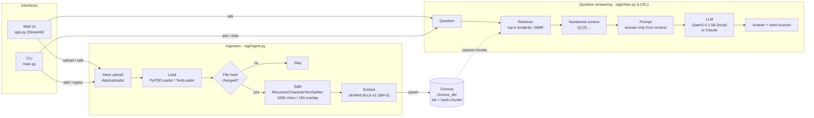
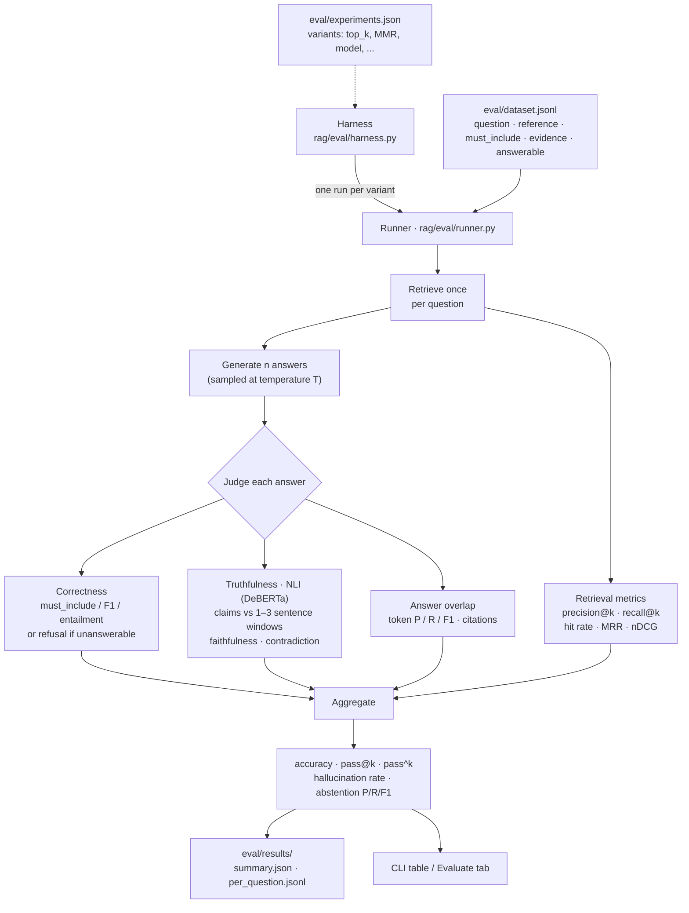

# RAG with LangChain

Question answering over your own documents using LangChain, a persistent Chroma
vector store, local HuggingFace embeddings, and either a local Hugging Face LLM
(default `Qwen/Qwen2.5-1.5B-Instruct`) or Claude as the generator. Answers
include numbered source citations. An eval harness measures retrieval quality,
correctness, pass@k / pass^k, and truthfulness.

## Layout

```
rag-langchain/
├── app.py               # web UI: upload & process, ask, browse chunks, evaluate
├── main.py              # CLI: ingest / add / docs / ask / chat / eval / bench
├── rag/
│   ├── config.py        # env-driven settings
│   ├── store.py         # Chroma vector store, embeddings, retriever
│   ├── ingest.py        # load -> split -> embed -> incremental upsert
│   ├── chain.py         # retriever + prompt + LLM (LCEL)
│   └── eval/
│       ├── dataset.py   # JSONL eval set loader
│       ├── metrics.py   # retrieval, token P/R/F1, pass@k, pass^k, ...
│       ├── truthfulness.py  # NLI faithfulness / contradiction
│       ├── runner.py    # single eval run -> report
│       └── harness.py   # multi-variant experiments + comparison table
├── eval/
│   ├── dataset.jsonl    # labeled questions
│   ├── experiments.json # variants for `bench`
│   └── results/         # run outputs (gitignored)
├── data/                # put your .pdf / .txt / .md files here
├── requirements.txt
└── .env.example
```

## Setup

```bash
python -m venv .venv && source .venv/bin/activate
pip install -r requirements.txt
cp .env.example .env        # ANTHROPIC_API_KEY only needed with LLM_PROVIDER=anthropic
```

## Usage

```bash
streamlit run app.py                           # web UI at http://localhost:8501 (see below)
python main.py add report.pdf notes.md         # copy files into data/uploads and index them
python main.py docs                            # list indexed documents
python main.py ingest                          # sync index with data/ (incremental)
python main.py ingest --rebuild                # drop and rebuild the index
python main.py ask "What are the pipeline stages of RAG?"
python main.py chat                            # interactive
python main.py eval -n 5 -k 1,3,5              # evaluate on eval/dataset.jsonl
python main.py bench                           # run + compare variants in eval/experiments.json
python main.py bench --only baseline,mmr -v
```

The web UI has four tabs:

- **Upload & process**: drop PDFs/TXT/MD; each file is processed automatically
  with live steps (save → extract → split → embed + store) and a per-file
  report (pages, characters, chunks, time).
- **Ask**: chat with your documents; every answer shows its sources and pages.
- **Documents**: indexed files, their chunks, and a remove button.
- **Evaluate**: run the eval harness and view accuracy, pass@k / pass^k,
  retrieval, truthfulness, and per-question results.

Ingestion is incremental: chunk ids derive from each file's content hash, so
unchanged files are skipped, edited files are re-embedded, and deleted files
are removed from the index.

## Evaluation

`eval/dataset.jsonl` holds one labeled question per line:

```json
{"id": "embed_dims", "question": "...", "reference": "gold answer",
 "must_include": ["384"], "evidence": ["384-dimensional embeddings"]}
{"id": "unans_price", "question": "...", "answerable": false}
```

For each question the harness retrieves once, generates `n` answers (sampled
at `--temperature` when n > 1), judges every answer, and aggregates:

| Group | Metrics |
|---|---|
| Generation | accuracy, pass@k (at least 1 of k correct), pass^k (all k correct), both with unbiased estimators |
| Retrieval | precision@k, recall@k, hit rate, MRR, nDCG (a chunk is relevant if it contains an `evidence` string) |
| Answer | token precision / recall / F1 vs `reference`, citation rate and validity |
| Truthfulness | faithfulness (claims entailed by retrieved text), contradiction rate, reference entailment, hallucination rate, claim coverage |
| Abstention | precision / recall / F1 of "I don't know" on unanswerable questions |

An answer is correct if it contains every `must_include` phrase (else token
F1 >= 0.5 or it entails `reference`); for unanswerable questions it must
refuse. Truthfulness uses a local NLI model
(`MoritzLaurer/DeBERTa-v3-base-mnli-fever-anli`) against 1-3 sentence windows
of the retrieved chunks. Very short answers (e.g. "384") have no checkable
claims and are excluded from faithfulness (`claim_coverage` reports how many
were scored).

`bench` reads `eval/experiments.json`: lower-case keys (`n`, `ks`,
`temperature`, `top_k`, `limit`, `dataset`) are run settings, UPPER_CASE keys
override `rag/config.py` (e.g. `SEARCH_TYPE`, `HF_LLM_MODEL`, `LLM_PROVIDER`).
Each run writes `per_question.jsonl` and `summary.json` under `eval/results/`.

## Configuration (env vars)

| Variable | Default |
|---|---|
| `LLM_PROVIDER` | `huggingface` (or `anthropic`) |
| `HF_LLM_MODEL` / `HF_MAX_NEW_TOKENS` | `Qwen/Qwen2.5-1.5B-Instruct` / `512` |
| `ANTHROPIC_API_KEY` / `LLM_MODEL` | only for `anthropic` / `claude-sonnet-4-5` |
| `EMBED_MODEL` | `sentence-transformers/all-MiniLM-L6-v2` |
| `CHUNK_SIZE` / `CHUNK_OVERLAP` | `1000` / `150` |
| `TOP_K` / `SEARCH_TYPE` | `4` / `similarity` (or `mmr`) |
| `NLI_MODEL` | `MoritzLaurer/DeBERTa-v3-base-mnli-fever-anli` |
| `DATA_DIR` / `PERSIST_DIR` | `./data` / `./chroma_db` |

## How it works

### Architecture



1. **Ingest:** files are loaded page by page, hashed, split into overlapping
   chunks, embedded locally, and upserted into Chroma. Unchanged files are
   skipped; edited or deleted files are replaced or removed.
2. **Ask:** the question is embedded, the top-k chunks are retrieved and
   formatted as numbered context blocks, and the LLM answers using only that
   context, citing `[1]`, `[2]`, ...

### Evaluation pipeline



pass@k is the chance that at least 1 of k sampled answers is correct; pass^k
is the chance that all k are. A large gap between them means the model can
answer but isn't consistent.

## Ideas to extend

- Add a reranker and compare it with `bench`.
- Add chat history with a history-aware retriever.
- Add an LLM-as-judge correctness check alongside the NLI metrics.
