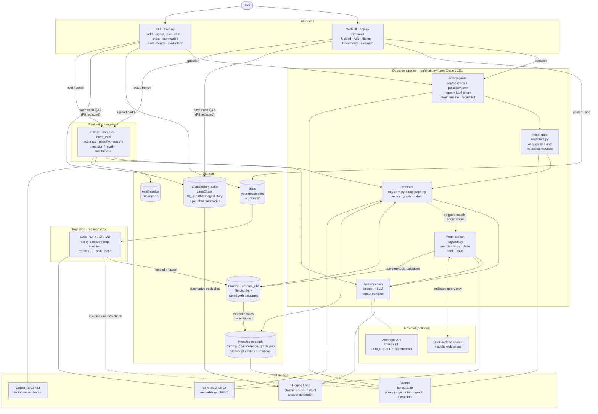
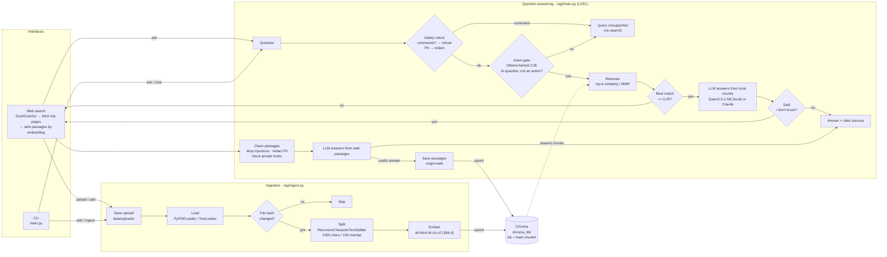
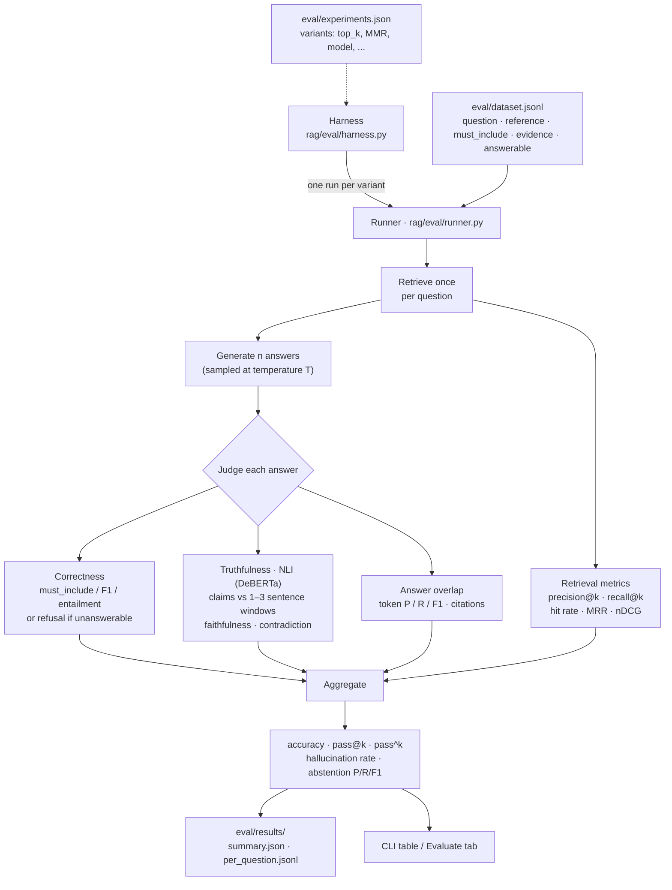

# LuminusRAG

*Guarded, self-evaluating GraphRAG for AI questions.*

Question answering over your own documents using LangChain, a persistent Chroma
vector store, local HuggingFace embeddings, and either a local Hugging Face LLM
(default `Qwen/Qwen2.5-1.5B-Instruct`) or Claude as the generator. Answers
include numbered source citations. An eval harness measures retrieval quality,
correctness, pass@k / pass^k, and truthfulness.

Only AI questions are answered. An Ollama model screens every question,
personal data is redacted before anything leaves the machine, and when the
local documents can't answer, the app searches the web and saves what it
learns. Latest scores are in [results.md](results.md).

## Architecture



| Layer | Component | Job |
|---|---|---|
| Interfaces | `app.py`, `main.py` | Upload documents, ask questions, browse chunks, run evals |
| Policy guard | `rag/policy.py`, `rag/safety.py`, `policies/*.json` | Reject questions that violate the prompt-injection or PII policy (regex rules, then an LLM judge); redact contact details; sanitize uploaded documents, web passages, and answers |
| Intent | `rag/intent.py` + Ollama | Let through only AI questions, and no requests to perform actions |
| Retrieval | `rag/store.py` + Chroma | Find the top-k chunks for the question |
| Generation | `rag/chain.py` + Qwen or Claude | Answer only from the retrieved context, with citations |
| Web fallback | `rag/web.py` + DuckDuckGo | Search when local data can't answer; clean, rank, and save passages |
| Chat history | `rag/history.py` + LangChain `SQLChatMessageHistory` | Save every chat, reopen it, and summarize each chat |
| Knowledge graph | `rag/graph.py` + NetworkX + Ollama | Extract AI entities and relations from chunks; add connected facts and chunks to retrieval (GraphRAG) |
| Ingestion | `rag/ingest.py` | Load, split, embed, and upsert files; skip unchanged ones |
| Evaluation | `rag/eval/` | Score retrieval, correctness, consistency, truthfulness, and the intent gate |

Everything runs locally except the web search and, if you choose it, Claude.

## Layout

```
LuminusRAG/
├── app.py               # web UI: upload & process, ask, browse chunks, evaluate
├── main.py              # CLI: ingest / add / docs / ask / chat / eval / bench
├── rag/
│   ├── config.py        # env-driven settings
│   ├── store.py         # Chroma vector store, embeddings, retriever
│   ├── ingest.py        # load -> split -> embed -> incremental upsert
│   ├── intent.py        # Ollama intent gate (AI questions only)
│   ├── web.py           # web fallback: search, fetch, clean, rank, store
│   ├── policy.py        # policy guard: regex + LLM checks against policies/*.json
│   ├── safety.py        # PII detectors, injection rules, output sanitizer
│   ├── history.py       # chat history (LangChain SQL store) + summaries
│   ├── graph.py         # GraphRAG: entity/relation extraction, graph store, hybrid retriever
│   ├── chain.py         # retriever + prompt + LLM (LCEL)
│   └── eval/
│       ├── dataset.py   # JSONL eval set loader
│       ├── metrics.py   # retrieval, token P/R/F1, pass@k, pass^k, ...
│       ├── truthfulness.py  # NLI faithfulness / contradiction
│       ├── intent_eval.py   # intent gate accuracy
│       ├── guard_eval.py    # policy guard on labeled attack / benign questions
│       ├── security_eval.py # full-pipeline PII + prompt-injection eval
│       ├── runner.py    # single eval run -> report
│       └── harness.py   # multi-variant experiments + comparison table
├── eval/
│   ├── dataset.jsonl    # labeled questions
│   ├── intent_dataset.jsonl # labeled allowed / blocked queries
│   ├── experiments.json # variants for `bench`
│   └── results/         # run outputs (gitignored)
├── policies/
│   ├── prompt_injection.json  # injection rules: patterns, examples, scope
│   └── pii.json               # PII rules and detectors
├── security-testing/    # poisoned test documents + original test plans
├── data/                # put your .pdf / .txt / .md files here
├── requirements.txt
└── .env.example
```

## Setup

```bash
python -m venv .venv && source .venv/bin/activate
pip install -r requirements.txt
cp .env.example .env        # ANTHROPIC_API_KEY only needed with LLM_PROVIDER=anthropic
```

Questions pass through an Ollama intent check, so install Ollama too:

```bash
brew install ollama
ollama serve                # keep running, or: brew services start ollama
ollama pull llama3.2:3b
```

## Usage

```bash
streamlit run app.py                           # web UI at http://localhost:8501 (see below)
python main.py add report.pdf notes.md         # copy files into data/uploads and index them
python main.py docs                            # list indexed documents
python main.py ingest                          # sync index with data/ (incremental)
python main.py ingest --rebuild                # drop and rebuild the index
python main.py ask "What are the pipeline stages of RAG?"
python main.py chat                            # interactive
python main.py eval -n 5 -k 1,3,5              # evaluate on eval/dataset.jsonl
python main.py bench                           # run + compare variants in eval/experiments.json
python main.py bench --only baseline,mmr -v
python main.py eval-intent                     # measure the intent gate
python main.py eval-guard                      # policy guard on 84 labeled attack/benign questions
python main.py eval-security -n 3              # full-pipeline PII + prompt-injection eval
python main.py graph build                     # extract new chunks into the knowledge graph
python main.py graph stats                     # entity and relation counts, most connected
python main.py graph show "HNSW"               # facts around an entity
python main.py chats                           # list saved chats
python main.py summarize                       # summarize each chat
python main.py summarize --overview            # ...plus an overview of all chats
python main.py summarize <chat_id>             # summarize one chat
```

The web UI has four tabs:

- **Upload & process**: drop PDFs/TXT/MD; each file is processed automatically
  with live steps (save → extract → split → embed + store) and a per-file
  report (pages, characters, chunks, time).
- **Ask**: chat with your documents; every answer shows its sources and pages.
- **Documents**: indexed files, their chunks, and a remove button.
- **Evaluate**: run the eval harness and view accuracy, pass@k / pass^k,
  retrieval, truthfulness, and per-question results.

Ingestion is incremental: chunk ids derive from each file's content hash, so
unchanged files are skipped, edited files are re-embedded, and deleted files
are removed from the index.

## GraphRAG (knowledge graph)

Vector search finds chunks that look like the question. A knowledge graph adds
what is *connected* to the things the question names, which helps when an
answer spans several chunks or documents (HNSW → ANN index → vector database
→ Chroma).

- **Build:** an Ollama model reads each stored chunk and extracts AI entities
  (concepts, models, techniques, metrics, tools, benchmarks, ...) and relations
  (`is_a`, `uses`, `stores`, `alternative_to`, ...). Entities must appear in
  the chunk text, relations must join two entities named in the same
  sentence, generic words and PII are dropped, and every node and edge keeps
  the ids of the chunks it came from. Chunks are already policy-sanitized, so
  injected text never reaches the graph.
- **Store:** a NetworkX graph in `chroma_db/knowledge_graph.json`, updated
  incrementally after `ingest`, after uploads, and when web passages are
  saved; facts from deleted chunks are removed.
- **Retrieve:** `RETRIEVAL_MODE=vector` (vector search only), `graph`
  (graph only, falling back to vector), or `hybrid` (vector results plus up
  to `GRAPH_K` chunks linked to the question's entities and a list of the
  connecting facts).
- **Browse:** the **Graph** tab in the web UI shows the most connected
  entities and draws the neighbourhood of any entity.

Hybrid is the default: on 10 relational questions it raised accuracy from
0.70 to 0.83 and pass^3 from 0.50 to 0.70 compared with vector search, and on
the original 21 questions it was on par (0.71 vs 0.73) with fewer
hallucinations. Graph-only retrieval was worse (0.60), because chunks the
graph did not capture are missed. See [results.md](results.md).

## Streaming

Answers stream in the web UI and in `ask` / `chat`. While the checks run, a
status line shows each stage (safety policies, AI-topic check, document
search, web search); then the answer appears as it is generated.

Streaming never bypasses the output sanitizer. Tokens are buffered into whole
sentences or lines, and each piece is sanitized (PII and secrets redacted,
images and unknown links removed) before it is shown, so raw model output
never reaches the screen. If the first sentence of a local answer is "I don't
know", it is not shown: generation stops and the web answer streams instead.

In code, `build_guarded_chain()` returns a `GuardedPipeline` with
`.invoke(question)` (final result), `.events(question)` (status, token, and
final events), and `.stream(question)` (answer text only).

## Chat history and summaries

Chats are stored with LangChain's `SQLChatMessageHistory`: each chat is a
session of `HumanMessage` / `AIMessage` objects in a local SQLite database
(`chats/history.sqlite`, gitignored), with answer metadata and sources kept in
`additional_kwargs`. Set `CHAT_DB_URL` to any SQLAlchemy URL (for example
Postgres) to share history between machines. Questions are saved with personal
data already redacted.

- **Web UI:** the sidebar lists chats to reopen or delete; **New chat** starts
  another. The **History** tab shows every chat with its own summary, a
  **Summarize each chat** button, and an overview of all chats.
- **CLI:** `chat` sessions are saved too; `chats` lists them and `summarize`
  summarizes each one.

Summaries come from the local model and are cached until the chat gets new
messages. To keep them honest, refused questions are hidden from the model
and listed separately under "Not answered", and the all-chats overview is
assembled from each chat's topics by code rather than generated, because the
small local model dropped and invented content when merging summaries.

## Intent gate

Every question from `ask`, `chat` and the web UI is classified by Ollama first.
Only AI questions are searched; the rest get "Query unsupported". If Ollama is
unreachable the gate fails closed: nothing is searched and the reply says the
intent check is unavailable. Set `INTENT_ENABLED=false` to turn the gate off.
`eval` and `bench` call retrieval directly, so they measure the RAG pipeline
without the gate; `eval-intent` measures the gate on its own.

## Policy guard

Two JSON policies define what is unsafe:

- `policies/prompt_injection.json`: PI-01 instruction override, PI-02 system
  prompt extraction, PI-03 source/file/secret exfiltration, PI-04 command or
  tool execution, PI-05 fake authority or mode switch, PI-06 encoded
  instructions, PI-07 instructions addressed to an AI inside content.
- `policies/pii.json`: PII-01 requests for another person's data, PII-02
  social engineering, PII-03 memory or training-data leakage, PII-04
  high-risk identifiers or credentials in the input (reject), PII-05 contact
  details (redact), plus the detectors used for redaction.

Each rule has a description, regex patterns, unsafe and safe examples, an
action, and `applies_to` (`query`, `document`, or both).

**Questions** go through `check_query` before anything else: regex rules and
detectors first, then an Ollama model prompted with each policy's rules and
examples. If either finds the question unsafe it is rejected, naming the rule.
If the model can't be reached, the question is rejected (fail closed).

**Uploaded documents** go through `sanitize_document` before indexing: HTML
comments and images are removed, paragraphs that break a document-scoped
injection rule are dropped (regex, or an LLM verdict whose quoted evidence is
verified in the text), and PII is redacted, including names of private
individuals found next to other personal data. Code blocks and text that only
discusses prompts or attacks are kept. Policy changes re-index all files.

**Answers** go through `sanitize_output`: PII and secrets are redacted, and
images and links to hosts outside the sources are removed. Source excerpts
are displayed as plain text.

## Safety

| Risk | Protection |
|---|---|
| Personal data leaving the machine | Emails, phone numbers, card numbers (Luhn-checked), SSNs, Aadhaar/PAN, IBANs, IP addresses, and API keys/passwords are redacted from the question before anything else runs. Only the redacted text reaches the intent model, the search engine, and the store. |
| Running commands | Nothing in the pipeline executes code: the LLMs have no tools and output is only displayed or stored as text. Questions containing shell, code, or SQL commands are refused before any model sees them. |
| Requests to perform actions | The Ollama intent gate refuses requests to run, fetch, access, send, or download anything, in any language. `eval-intent` includes Spanish, French, and Hindi examples. |
| Instructions hidden in web pages | Hidden elements (`display:none`, `hidden`, `aria-hidden`, zero-size text) are removed; passages with injection phrases (several languages) are dropped; the prompt tells the model to treat context as data. |
| Fetching internal resources | Only public `http(s)` URLs on ports 80/443 are fetched. Hosts resolving to loopback, private, link-local, or reserved IPs are refused, including after redirects. |
| Personal data stored from the web | Web passages are PII-redacted before they are answered from or saved. |

Pattern-based checks can't catch everything (for example, names are not
detected as PII). With `LLM_PROVIDER=anthropic`, the redacted question and
context are sent to the Anthropic API.

## Web fallback

Allowed questions that the local store can't answer are searched online with
DuckDuckGo (no API key). The top pages are fetched, cleaned of navigation and
scripts, split into chunks, and ranked by embedding similarity to the question;
the best passages become the context. When they produce a real answer, the
passages that closely match the question (cosine >= `WEB_STORE_MIN_SCORE`,
default 0.45) are saved into Chroma (`origin=web`, with URL, title, and fetch time),
so later questions on the same topic are answered locally. Stored web passages
appear in the Documents tab with a remove button, and `ingest` leaves them
alone. Set `WEB_STORE=false` to answer from the web without saving. Set
`WEB_FALLBACK=false` to answer from local documents only. DuckDuckGo may rate
limit heavy use; failures are reported and the answer falls back to "I don't
know".

## Evaluation

`eval/dataset.jsonl` holds one labeled question per line:

```json
{"id": "embed_dims", "question": "...", "reference": "gold answer",
 "must_include": ["384"], "evidence": ["384-dimensional embeddings"]}
{"id": "unans_price", "question": "...", "answerable": false}
```

For each question the harness retrieves once, generates `n` answers (sampled
at `--temperature` when n > 1), judges every answer, and aggregates:

| Group | Metrics |
|---|---|
| Generation | accuracy, pass@k (at least 1 of k correct), pass^k (all k correct), both with unbiased estimators |
| Retrieval | precision@k, recall@k, hit rate, MRR, nDCG (a chunk is relevant if it contains an `evidence` string) |
| Answer | token precision / recall / F1 vs `reference`, citation rate and validity |
| Truthfulness | faithfulness (claims entailed by retrieved text), contradiction rate, reference entailment, hallucination rate, claim coverage |
| Abstention | precision / recall / F1 of "I don't know" on unanswerable questions |

An answer is correct if it contains every `must_include` phrase (else token
F1 >= 0.5 or it entails `reference`); for unanswerable questions it must
refuse. Truthfulness uses a local NLI model
(`MoritzLaurer/DeBERTa-v3-base-mnli-fever-anli`) against 1-3 sentence windows
of the retrieved chunks. Very short answers (e.g. "384") have no checkable
claims and are excluded from faithfulness (`claim_coverage` reports how many
were scored).

`bench` reads `eval/experiments.json`: lower-case keys (`n`, `ks`,
`temperature`, `top_k`, `limit`, `dataset`) are run settings, UPPER_CASE keys
override `rag/config.py` (e.g. `SEARCH_TYPE`, `HF_LLM_MODEL`, `LLM_PROVIDER`).
Each run writes `per_question.jsonl` and `summary.json` under `eval/results/`.

## Configuration (env vars)

| Variable | Default |
|---|---|
| `LLM_PROVIDER` | `huggingface` (or `anthropic`) |
| `HF_LLM_MODEL` / `HF_MAX_NEW_TOKENS` | `Qwen/Qwen2.5-1.5B-Instruct` / `512` |
| `ANTHROPIC_API_KEY` / `LLM_MODEL` | only for `anthropic` / `claude-sonnet-4-5` |
| `EMBED_MODEL` | `sentence-transformers/all-MiniLM-L6-v2` |
| `CHUNK_SIZE` / `CHUNK_OVERLAP` | `1000` / `150` |
| `TOP_K` / `SEARCH_TYPE` | `4` / `similarity` (or `mmr`) |
| `RETRIEVAL_MODE` / `GRAPH_K` | `hybrid` (or `vector`, `graph`) / `2` |
| `GRAPH_ENABLED` / `GRAPH_MODEL` | `true` / `llama3.2:3b` |
| `INTENT_ENABLED` / `INTENT_MODEL` | `true` / `llama3.2:3b` |
| `OLLAMA_BASE_URL` | `http://localhost:11434` |
| `WEB_FALLBACK` / `WEB_MIN_SCORE` | `true` / `0.25` |
| `WEB_STORE` / `WEB_STORE_MIN_SCORE` | `true` / `0.45` |
| `WEB_MAX_RESULTS` / `WEB_FETCH_PAGES` / `WEB_TIMEOUT` | `5` / `3` / `10` s |
| `CHAT_DB_URL` | `sqlite:///chats/history.sqlite` |
| `NLI_MODEL` | `MoritzLaurer/DeBERTa-v3-base-mnli-fever-anli` |
| `DATA_DIR` / `PERSIST_DIR` | `./data` / `./chroma_db` |

## How it works

### Request flow



1. **Ingest:** files are loaded page by page, hashed, split into overlapping
   chunks, embedded locally, and upserted into Chroma. Unchanged files are
   skipped; edited or deleted files are replaced or removed.
2. **Intent gate:** an Ollama model classifies the question as RAG architecture,
   AI model architecture, LLM architecture, general AI, or unsupported.
   Unsupported questions get "Query unsupported" and are never searched.
3. **Web fallback:** if no local chunk is a good match, or the model answers
   "I don't know" from the local chunks, the app searches DuckDuckGo, fetches
   the top pages, keeps the passages closest to the question, and answers
   from those, citing the URLs. Answers show whether they came from local
   documents or the web.
4. **Ask:** the question is embedded, the top-k chunks are retrieved and
   formatted as numbered context blocks, and the LLM answers using only that
   context, citing `[1]`, `[2]`, ...

### Evaluation pipeline



pass@k is the chance that at least 1 of k sampled answers is correct; pass^k
is the chance that all k are. A large gap between them means the model can
answer but isn't consistent.

## Ideas to extend

- Add a reranker and compare it with `bench`.
- Add chat history with a history-aware retriever.
- Add an LLM-as-judge correctness check alongside the NLI metrics.
